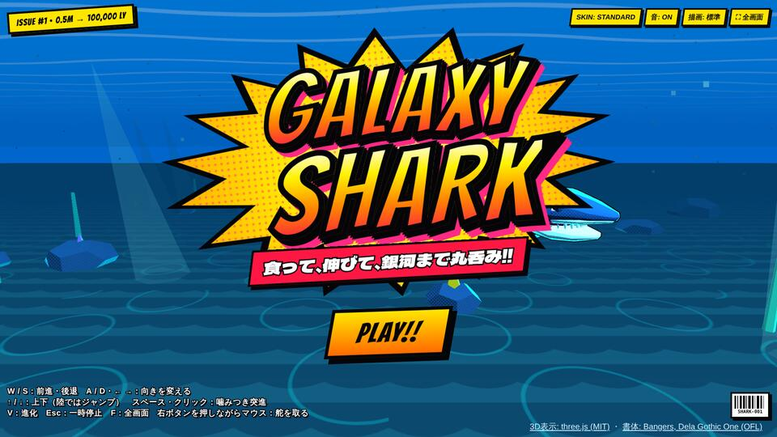
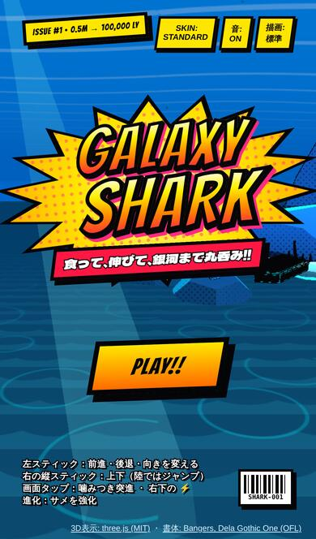

# GALAXY SHARK 修正報告書

- 対象: `docs/playtest/playtest_report.md`（テストプレイ報告書）で挙げた問題
- 修正日: 2026年11月27日

この文書は、テストプレイ報告書で見つけた問題を、どのように直したかをまとめたものです。番号（4-1 など）は、テストプレイ報告書の見出しの番号と同じです。最後に、直しきれなかったことと、持ち主に判断してほしいことを書きました。

---

## 1. 数字で見る変化

まず、自動で遊ぶプログラム（ボット）で通しプレイした結果を、直す前と比べます。時間はすべてゲームの中の時間です。

| 遊び方 | 直す前 | 直したあと |
|---|---|---|
| 噛みつきを連打 | 1分38秒でクリア、最低HP 94、ボス戦 5〜8秒 | 4分9秒でクリア、最低HP 82、ボス戦 15〜17秒 |
| 近いときだけ噛む | 1分41秒でクリア、最低HP 78 | 巨大ロボ戦で倒れることがある（2分7秒で敗北の回あり） |
| 一度も噛まない | 2分10秒でクリア | 25分たっても1体も食べられない |
| フェーズ2の5秒間に食べた数 | 690体 | 93体 |

ボットは、人間より正確に動けます。そのため、人間が初めて遊ぶ場合は、この2〜3倍の時間がかかると見込んでいます。ただし、人間での計測はしていないので、実際の時間はわかりません。

---

## 2. 重大な問題の修正

### 4-1 と 4-2：手応えがない、噛まなくてもクリアできる

噛みつきの役割を、はっきり分けました。今は、獲物の大きさで次の3つに分かれます。

- 自分の体長の40%以下の獲物：体が触れるだけで食べられる
- 40〜68%の獲物：噛みついたときだけ丸呑みできる
- それより大きい獲物：噛みついて体力を削る。噛まずにぶつかると「BONK!」とはね返され、格上の敵ならダメージを受ける

ボスについても、噛みついたときだけダメージが入るように変えました。噛まずに体当たりすると、はね返されてダメージを受けます。

さらに、ボスがダウンしていないときの噛みつきは、威力を4割に落としました。そのぶん、攻撃の直前に噛み返してダウンを奪うと、大きく削れます。瀕死のボスを一口で丸呑みにする決め技も、ダウン中だけ使えるように絞りました。

噛みつきの間隔は、0.28秒から0.42秒に延ばしました。これで、連打するだけでは弾を防ぎきれなくなります。

成長の速さも抑えました。1回食べたときに伸びる量をおよそ3分の2にし、コンボによる上乗せの上限を2.5倍から1.5倍に下げています。コンボを受け付ける時間も、続くほど短くなります。フェーズ5でラスボスが出てくる体長も引き上げたので、銀河を泳ぐ時間が約30秒になりました。

### 4-3：進化メニュー中に攻撃され、画面が壊れる

進化メニューを開いている間は、世界の時間を完全に止めました。敵の攻撃も止まります。さらに念のため、次の2つの守りも入れました。

- 結果画面を出すときと、新しいゲームを始めるときに、進化メニューを必ず閉じる
- カードを押したときに、その場で「買えるか」を確かめ直す

再現用のプログラムで確かめたところ、メニュー中にダメージを受けなくなり、ポイントがマイナスになることもなくなりました。

### 4-4：パソコンで噛めない、マウスで勝手に曲がる

スペースキー、Jキー、Enterキーで噛みつけるようにしました。押しっぱなしの連射はしません。

マウスでの舵取りは、右ボタンを押している間だけ効くように変えました。手を離せば、サメは勝手に曲がりません。照準の丸も、右ボタンを押している間だけ表示します。

タイトル画面と一時停止画面の操作説明は、パソコンとスマホで別の文章を出すようにしました。

### 4-5：スコアとランクが壊れている

スコアは、腕前が表れるものを柱にして作り直しました。具体的には、ボス撃破、カウンター成功、金色レアを食べた数、クリアの早さ、受けたダメージの少なさです。食べた数とコンボは、上限付きの小さなボーナスにとどめています。

ランクの基準は、ボットの成績が S と S+ の間に入るように決めました（S+ 7万点、S 5万5千点、A 4万2千点、B 3万点）。直したあとの連打ボットは、約6万7千点で S ランクでした。結果画面には「腕前」の欄を足し、ボス撃破数、カウンター回数、レアの数、被ダメージを表示します。やられたときは、「クリアタイム」ではなく「到達タイム」と表示します。

### 4-6：Three.js を読み込めないと何も起きない

Three.js r128（MIT ライセンス）を、`vendor/three.min.js` としてリポジトリに入れました。ライセンス文は `vendor/three.LICENSE` にあります。同梱のファイルが読めないときだけ、配布元（CDN）から読み直します。

それでも読み込めないときや、3D表示（WebGL）が使えない端末では、「ゲームを表示できませんでした」というお知らせを、理由と再読み込みのボタン付きで出します。あわせて、公開の処理（`.github/workflows/pages.yml`）が `vendor` フォルダも配置するように変えました。

---

## 3. 優先度「高」の問題の修正

**5-1 ボスを無視すると成長し続ける。** ボスが出ている間は、体長がそのフェーズの上限を超えないようにしました。フェーズ1なら49m、フェーズ2なら490mで止まります。ボスが出ている間は、ほかの獲物の数も6割に減らしました。

**5-2 フェーズ2で1秒に140体食べる。** 家とビルの割合を78%から40%に下げ、ステージごとの出現条件を守るようにしました。発電所・ダム・海底熱水噴出孔は、同時に1つまでにしています。水没中に感電で一緒に食べる数は、5体までです。

**5-3 画面が止まってカクつく。** 画面を一瞬止める演出は、自分と同じくらい大きい獲物、レア、ボスへの一撃、カウンターだけに使います。前の演出から0.25秒たつまでは、次を入れません。

**5-4 やり直しで前回の状態が残る。** BGMのフェーズと、ダム決壊の水面を初期状態に戻しました。最初の進化の説明は、一度終えるとブラウザに記録し、2回目からは出しません。

**5-5 描画命令が多い。** 2つの手を入れました。

1つ目に、標準表示でも、遠くの獲物のふち取りを省くようにしました。

2つ目に、設定で選べる「描画: 軽量」を足しました。軽量表示では、獲物のモデルの部品を材質ごとに1つの形へまとめ、獲物の種類ごとに3通りまで作って使い回します。その代わり、プロペラや尾ビレなどの細かな部品の動きと、黒いふち取りは省きます。惑星の自転のように、獲物全体が回る動きは残しています。あわせて、背景の飾り（サンゴ、雲など）の数も減らします。

1画面あたりの描画命令の数を比べると、次のようになりました。

| フェーズ | 標準 | 軽量 |
|---|---|---|
| 1 海洋 | 約1,330回 | 約370回 |
| 2 地上・都市 | 約890回 | 約460回 |
| 3 大気圏 | 約1,770回 | 約470回 |
| 4 宇宙 | 約1,430回 | 約460回 |
| 5 銀河 | 約630回 | 約300回 |

切り替えのボタンは、タイトル画面の右上と、遊んでいる最中の「⚙ MENU」の中にあります。遊んでいる最中に切り替えても、いま出ている獲物をその場で作り直します。選んだ設定は保存され、次に開いたときも引き継がれます。初期値は「標準」です。

**5-6 スマホで表示が重なる。** 縦画面のボス戦では、ボスの体力バーを左上の表示の下へ自動でずらします。結果画面のボタンは、箱の下に固定したので、横画面でも常に見えます。横画面のタイトルでは、ロゴと説明文を小さくして、説明文が切れないようにしました。

**5-7 案内が3つ同時に出る。** 案内は、1つずつ順番に出すようにしました。「物語の見出し → 噛みつきの案内（実際に噛むまで出しておく）→ 成長ゲージの説明」の順です。ゲージの説明の箱は、ゲージの真下に出すので、ゲージを隠しません。

---

## 4. 優先度「中」の問題の修正

**6-1 食べられるかが分からない。** 近くの獲物のうち、触れるだけでは食べられないものに、小さな三角の目印を付けました。黄色は「噛めば丸呑み」、赤は「大きいので噛んで削る」の意味です。目印の意味は、ゲージの説明でも伝えます。

**6-2 ゲージとボス出現のずれ。** ボスが出る位置に、ゲージの上で ☠ の印を出します。

**6-3 金色レア。** 場にレアがいないとき、30秒ごとに出すようにしました（前は65秒）。逃げる速さは、サメの全速力の88%までに抑えています。25秒逃げ切ると、レアは消えます。出たときは「噛みつき突進で追いつけ!!」と知らせます。

**6-4 進化の説明と効果のずれ。** 次のように直しました。

- 「流線ヒレ強化」で、実際に曲がる速さが20%上がるようにした
- 「破砕クラッシュ顎」の+30%は、説明どおり格上とボスだけに効くようにした
- 「レーザー・シャーク」は、レーザーの線の上にいる獲物すべてに当たるようにし、線も描くようにした
- ポイント0で隠し形態を無料で開けるときは、ボタンに「隠し形態 解放!!」と出すようにした
- 「ゴースト・シャーク」の説明を、実際の効果（被ダメージ40%減）に合わせた

**6-5 使われていない機能の言葉。** 「テールスラップ」「ドリル回転」「尻尾ビンタ」の文章を直しました。使われていない関数と古い見出しも消しました。各獲物の紹介文は、初めて食べたときに画面下へ2.6秒だけ出します。

**6-6 空振りでも食べた音。** 空振りは、軽い「カチッ」の音にしました。同じ食べる音は0.05秒以内に重ねて鳴らさないので、大量に食べたときの音割れと処理の負担も抑えられます。

**6-7 ボス名の「（ボス）」。** 画面には「VS クラーケン!!」のように表示します。

**6-8 大きな数の表示。** 万・億・兆・京・垓・秭・穣の単位を順に使うようにしました。たとえば「6000000000.00 兆t」は「60.00 垓t」、「500000.00 万km」は「50.00 億km」と表示します。

**6-9 擬音が画面をおおう。** 同時に出す擬音は、普段は4つまでにしました。大事なもの（カウンター、レアなど）は、古いものを押し出して最大8つまで出します。

**6-10 巨大ロボの頭が切れる。** 巨大ロボ戦の間だけ、カメラを引いて高い位置から見下ろすようにしました。

**6-11 後ろの獲物がすぐ消える。** 削り途中の獲物と、攻撃態勢に入った敵は、後ろへ回っても消さないようにしました。

**6-12 大きさの表示が止まる区間。** 大きさの単位の切り替えに1,500万mの段を足しました。これで、どの段も10倍前後の幅に収まります。

**6-13 ニュースと状況のずれ。** ステージが上がったときのニュースは、「巨大サメが体長○○に成長!! STAGE ○ 突破!!」のように、そのときの体長を伝える文に変えました。

---

## 5. 優先度「低」の問題の修正

**7-1 設定と言葉づかい。** 設定を保存するようにしました（スキン、音、スティック表示、24FPS、点滅軽減、揺れ、描画）。音のボタンは「音: ON」に、結果画面のボタンは「もう一度遊ぶ」に直しました。スマホでは、キーボードの「(ESC)」の表記を出しません。

**7-2 体にやさしい表示。** 「揺れ: 強／弱／切」の設定を足しました。点滅軽減を ON にすると、攻撃予告の文字の点滅や、ボタンの点滅アニメーションも止まります。端末が「視差効果を減らす」設定になっている場合は、最初から揺れを弱め、点滅軽減を ON にします。

**7-3 公開まわり。** ページの説明文、SNS で共有したときの説明（OGP）、タブに出る小さなアイコン、テーマカラーを足しました。タイトル画面の右下には、Three.js のライセンスへのリンクを置きました。

**7-5 そのほか。** 次の点を直しました。

- 縦画面でロゴが黒くつぶれないよう、ふち取りの太さを文字の大きさに合わせた
- 「ISSUE #1」の札が途中で折り返さないようにした
- 重ねて描く2D演出を、画面の細かさに合わせて描くようにした
- 最近の iPad をタブレットとして判定するようにした
- ボス戦ではBGMの速さと音色が変わるようにした

---

## 6. 直しきれなかったこと・判断してほしいこと

**描画命令の数（5-5）。** 軽量表示を選べば、描画命令は標準のおよそ3分の1〜4分の1になります。ただし、初期値は今も「標準」です。本物のスマホで重いと感じた場合は、スマホでは最初から軽量表示にする、という選び方もできます。この判断は、実機で試してからがよいと考えます。

**コンボが途切れない。** 前方に獲物が常に補充されるため、コンボは今も数千まで続きます。成長への上乗せとスコアには上限を付けたので、ゲームの壊れにはつながりません。ただ、「コンボをつなぐ緊張感」を出したい場合は、獲物の補充の仕方から見直す必要があります。

**内容の表現（7-4）。** 市民を食べる表現や、実在の組織名は変えていません。公開先の規約に合わせて、持ち主が判断してください。

**画面の拡大の禁止。** ゲーム中に指の動きで画面が拡大されるのを防ぐため、今の設定（`user-scalable=no`）のままにしています。

**実機での確認。** 今回も、画面のないブラウザで確かめています。本物のスマホでの手ざわり、速さ、音は確かめられていません。公開前に、一度スマホで通しプレイすることをおすすめします。

---

## 7. 確かめ方

テストプレイ報告書の10章と同じ道具で、同じ確認をやり直せます。Three.js は同梱したので、`THREE_PATH` には `vendor/three.min.js` を指定すれば動きます。

```bash
export THREE_PATH=$PWD/vendor/three.min.js
node docs/playtest/tools/bot.js spam 1500      # 通しプレイ（連打）
node docs/playtest/tools/bot.js smart 1500     # 通しプレイ（近いときだけ噛む）
node docs/playtest/tools/bugs.js               # 個別の不具合の再現
node docs/playtest/tools/bugs2.js              # 古いカード、最初の進化の説明、金色レア
node docs/playtest/tools/perf.js               # 描画命令の数（標準表示）
node docs/playtest/tools/perf.js light         # 描画命令の数（軽量表示）
```

---

## 8. 追加：PC向けの表示

PCで開いたときは、次の2点を変えました。スマホの表示は変えていません。

**全画面表示。** 全画面に対応したPCのブラウザでは、タイトル画面の右上と、遊んでいる最中の上のボタン列に「⛶ 全画面」ボタンを出します。F キーでも切り替えられます。全画面の間は、ボタンの表示が「全画面を終了」に変わります。

**大きな画面に合わせた表示。** これまで、体長やHPの表示、ボタン、進化のカード、結果画面などは、画面の大きさにかかわらずスマホ向けの大きさのままでした。今は、1280×760を基準に、画面の大きさに合わせて1〜2倍に拡大します。たとえば1920×1080では約1.4倍、2560×1440では約1.9倍です。獲物の上に出る目印や文字も、同じ倍率で大きくなります。1280×720、1920×1080、2560×1440のどれでも、結果画面のボタンが画面内に収まることを確かめました。

あわせて、スキンを切り替えたときに、ページの見た目の設定（点滅軽減など）が消えてしまう不具合も直しました。

---

## 9. 追加：タイトルの書体

タイトルのロゴとキャッチコピーを、アメコミらしい書体に変えました。これまでの書体の指定（Impact など）は、端末に入っていないと、ふつうの太字に置き換わっていました。今は、書体のファイルをゲームに埋め込んでいるので、どの端末でも同じ見た目になります。

ロゴ「GALAXY SHARK」には、アメコミの見出し風の英字書体 Bangers を使いました。ロゴは、黄色い網点の入ったギザギザの爆発の上に乗せ、影を少しずつずらして重ねて、立体的に飛び出して見えるようにしています。キャッチコピー「食って、伸びて、銀河まで丸呑み!!」には、太い日本語書体 Dela Gothic One を使い、赤い帯の上に白い文字で載せました。PLAY ボタンと「ISSUE #1」の札も、Bangers にそろえています。

書体は、使う字だけに絞って埋め込んだので、増えたのは約22KBです。どちらも SIL Open Font License 1.1 で配布されている書体で、ライセンス文は `vendor/fonts.LICENSE` にあります。タイトル画面の右下からも開けます。点滅軽減を ON にしているときは、ロゴが飛び出す動きを止めます。




なお、キャッチコピーの文章を変えるときは、新しく使う字を書体ファイルに足す必要があります。足さない字は、端末の標準の太字で表示されます。

